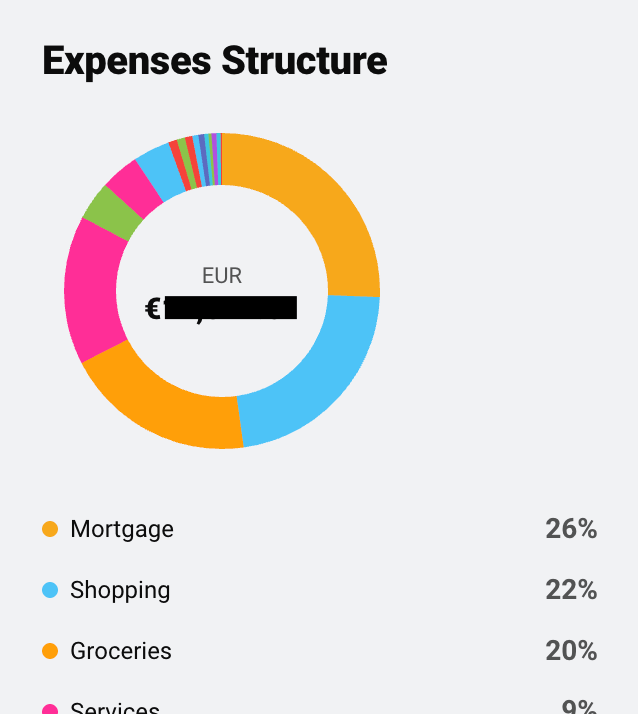

<p align="center">
  
</p>

# ha-wallet-card

Lovelace card set for the [**Wallet by BudgetBakers**](https://github.com/nuggetz/ha-wallet)
Home Assistant integration. Reproduces the Wallet web dashboard as native, theme-aware HA
cards — analytics, a quick cash-entry keypad, and write-side action cards for records,
transfers, budgets, categories, accounts, labels and automations.

> **Unofficial** — not affiliated with or endorsed by BudgetBakers. "Wallet by BudgetBakers"
> is used only to name the app this integration talks to. Brand: **nugg3tz** · License: MIT.

This is the companion front-end for the `ha_wallet` custom component. Install the
[integration](https://github.com/nuggetz/ha-wallet) first — the cards read its
`sensor.wallet_by_budgetbakers_*` entities and call its `ha_wallet.*` services.

## Preview

<p align="center">
  
  &nbsp;
  
  &nbsp;
  
</p>
<p align="center"><sub><em>A taste of the set — the Spending gauge, the Expenses Structure donut,
and the Quick-Add keypad. All 21 cards are listed below.</em></sub></p>

---

## Requirements

- Home Assistant with the [`ha_wallet`](https://github.com/nuggetz/ha-wallet) integration
  installed and configured (v0.1.0+).
- The integration must have exposed its sensors (accounts/budgets selected in the options flow).

## Install

### HACS (recommended)

1. HACS → **Frontend** → three-dot menu → **Custom repositories**.
2. Add `https://github.com/nuggetz/ha-wallet-card` with category **Lovelace**.
3. Install **Wallet by BudgetBakers Cards**, then reload your browser.

HACS registers the resource automatically. If you install manually, add the resource
yourself: **Settings → Dashboards → three-dot menu → Resources → Add**
`/hacsfiles/ha-wallet-card/ha-wallet-card.js` as a **JavaScript module**.

### Manual

Download `ha-wallet-card.js` from the [latest release](https://github.com/nuggetz/ha-wallet-card/releases),
drop it in `config/www/`, and add it as a JavaScript-module resource pointing to
`/local/ha-wallet-card.js`.

---

## Cards

Every card is theme-aware (light/dark, HA theme variables) and ships four states:
**default**, **empty**, **loading** (skeleton) and **error** (stale badge / can't-reach hint).

### Analytic (12)

| Card type | Reads |
|---|---|
| `wallet-cash-flow-card` | `sensor.wallet_by_budgetbakers_cash_flow` |
| `wallet-cash-flow-trend-card` | history/LTS of `…_cash_flow` |
| `wallet-spending-card` | `…_spending` (gauge) |
| `wallet-nature-of-spending-card` | `…_spending_by_cardinality` |
| `wallet-balance-by-currencies-card` | `…_balance_<currency>` (all) |
| `wallet-spending-by-categories-card` | `…_spending` → `by_category` |
| `wallet-credit-limits-card` | `…_credit_utilization` |
| `wallet-balance-trend-card` | history/LTS of `…_balance_<currency>` |
| `wallet-expenses-structure-card` | `…_spending` → `by_category` (donut) |
| `wallet-period-comparison-card` | history/LTS of `…_cash_flow` |
| `wallet-last-records-card` | `…_last_records` → `records` |
| `wallet-accounts-card` | `…_account_<name>` (all) |

### Quick entry (1)

| Card type | Calls |
|---|---|
| `wallet-quick-add-card` | `ha_wallet.add_record` (keypad, category chips, account picker) |

### Action / write-side (8)

| Card type | Calls |
|---|---|
| `wallet-records-action-card` | `add_record` / `update_record` / `delete_record` |
| `wallet-transfer-card` | `add_transfer` |
| `wallet-budgets-action-card` | `manage_budget` |
| `wallet-categories-action-card` | `manage_category` |
| `wallet-accounts-action-card` | `manage_account` (create/patch) |
| `wallet-labels-action-card` | `manage_label` (create/patch) |
| `wallet-automations-action-card` | `delete_standing_order` / `delete_record_rule` |
| `wallet-import-history-card` | `ha_wallet.import_history` — **only shown if the service exists** (deferred to 0.1.x) |

---

## Usage

Add a card in YAML mode (each card auto-discovers its entity from the `ha_wallet` device,
or you can pin it explicitly):

```yaml
# Auto-discovers the cash-flow sensor from the Wallet device
type: custom:wallet-cash-flow-card

# Or bind an explicit entity / title / period label
type: custom:wallet-spending-card
entity: sensor.wallet_by_budgetbakers_spending
title: Spending
```

The Quick-Add and action cards need no entity — they enumerate accounts/categories/labels
from the device and call services:

```yaml
type: custom:wallet-quick-add-card
```

Bank-synced accounts are read-only: the write cards block record creation/edit/delete on them
and surface the integration's error inline.

---

## Design notes

- **Data surfaces** use Home Assistant theme variables (surfaces, text, dividers) so cards
  match your theme in light and dark with no config. **Brand accents** (nugg3tz amber/acid)
  and Wallet **category/semantic colors** are the only fixed colors.
- **Trends** read Home Assistant long-term statistics (recorder history), not per-poll API
  calls. Fresh installs fill from install date forward.
- No number on a card is invented — every value maps to a `ha_wallet` sensor attribute or
  service field. See the integration's `architecture/entity-contract.md`.

## Development

```bash
npm install
npm run build     # bundles src/ → dist/ha-wallet-card.js
npm run watch     # rebuild on change
npm run lint      # tsc --noEmit
```

## License

[MIT](LICENSE) © nugg3tz
